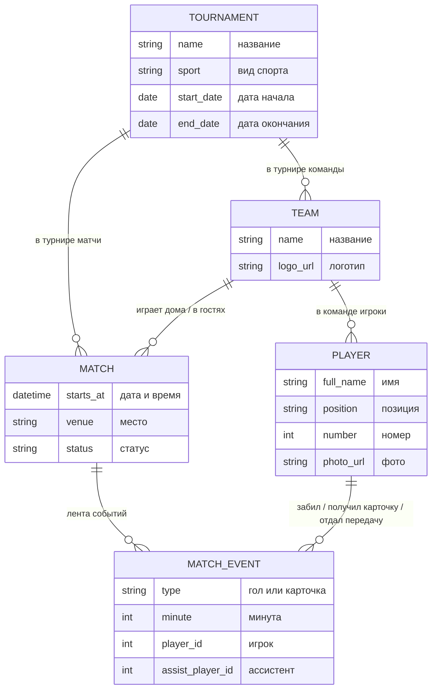

# Матчдей

Веб-приложение для студенческих спортивных турниров: ведение матча в реальном
времени, турнирная таблица, статистика игроков, фэнтези-лига и зрительское
голосование.

Курсовой проект, осень 2026.

## Что нужно установить

Только две программы. Python и Node ставить **не нужно** — они живут внутри
контейнеров.

| Программа | Windows | macOS |
|---|---|---|
| Git | [git-scm.com/download/win](https://git-scm.com/download/win) | `xcode-select --install` в терминале |
| Docker Desktop | [docker.com/products/docker-desktop](https://www.docker.com/products/docker-desktop/) | то же самое, версия для Apple Silicon |

После установки Docker Desktop **запустите его** и дождитесь, пока значок кита
перестанет мигать. Если Docker не запущен, все команды ниже выдадут ошибку
`cannot connect to the Docker daemon`.

## Запуск

Откройте терминал (на Windows — «Git Bash», он ставится вместе с Git;
на macOS — «Терминал») и выполните по очереди:

```bash
git clone https://github.com/matchdayy/matchday.git
cd matchday
cp .env.example .env
docker compose up --build
```

Первый запуск занимает 3–5 минут: скачиваются образы и ставятся зависимости.
Последующие — несколько секунд.

Когда в терминале перестанут бежать строки, откройте в браузере
**http://localhost:5173**

Должна появиться карточка с надписью «Бэкенд отвечает: ok» зелёным цветом.
Если видите её — окружение поднято, всё работает.

**Создайте таблицы в базе.** После первого запуска база пустая. Откройте
второй терминал в папке проекта и выполните:

```bash
docker compose exec backend alembic upgrade head
```

В конце должна появиться строка `Running upgrade ... -> ...`. Повторять
команду нужно каждый раз, когда кто-то добавил новую миграцию (после
`git pull`). Если новых миграций нет, команда просто ничего не сделает.

Остановить: `Ctrl+C` в том же терминале, затем `docker compose down`.

## Что где лежит

```
matchday/
├── backend/            сервер на Python
│   ├── app/
│   │   ├── main.py     точка входа, здесь объявлены ручки API
│   │   ├── config.py   настройки из переменных окружения
│   │   ├── database.py подключение к базе
│   │   └── models/     таблицы базы данных, по файлу на таблицу
│   ├── migrations/     миграции: история изменений структуры базы
│   ├── alembic.ini     настройки Alembic
│   └── requirements.txt список библиотек Python
├── frontend/           клиент на React
│   └── src/
│       ├── App.tsx     главный компонент
│       └── main.tsx    точка входа
├── docker-compose.yml  описание трёх контейнеров: база, бэкенд, фронт
└── .env.example        пример настроек
```

## Адреса

| Что | Адрес |
|---|---|
| Приложение | http://localhost:5173 |
| API | http://localhost:8000/api/health |
| Документация API | http://localhost:8000/docs |
| База данных | localhost:**5433**, пользователь `postgres`, пароль `postgres` |

## Какие данные есть в системе

Этот раздел для всех, включая дизайнеров: здесь видно, что приложение умеет
хранить. Рисовать экран можно только под эти данные. Если для экрана нужно
что-то, чего здесь нет, заведите задачу на бэкенд.

### Как сущности связаны



Проще говоря: в **турнире** есть **команды** и **матчи**. В команде есть
**игроки**. Каждый матч — это две команды одного турнира. У матча есть
**лента событий**: голы и карточки по минутам.

### Турнир

| Поле | Что значит | Обязательно | Пример |
|---|---|---|---|
| Название | | да | Кубок первокурсников 2026 |
| Вид спорта | латиницей | да | `football` |
| Дата начала | | да | 1 ноября 2026 |
| Дата окончания | не раньше даты начала | да | 30 ноября 2026 |

### Команда

| Поле | Что значит | Обязательно | Пример |
|---|---|---|---|
| Турнир | в каком турнире играет | да | |
| Название | в одном турнире не повторяется | да | ФКН United |
| Логотип | ссылка на картинку | нет | |

### Игрок

| Поле | Что значит | Обязательно | Пример |
|---|---|---|---|
| Команда | за кого играет | да | |
| Имя | имя и фамилия | да | Иван Петров |
| Позиция | свободным текстом | нет | вратарь |
| Номер | от 0 до 99, в команде не повторяется | нет | 10 |
| Фото | ссылка на картинку | нет | |

Игрок привязан к одной команде. Если студент играет в двух турнирах,
это две разные записи.

### Матч

| Поле | Что значит | Обязательно | Пример |
|---|---|---|---|
| Турнир | | да | |
| Хозяева и гости | две разные команды | да | |
| Дата и время | когда начинается | да | 12 ноября 2026, 18:30 |
| Место | | нет | Спортзал корпуса Б |
| Статус | запланирован, идёт, завершён, отменён | да | идёт |

### Событие матча

| Поле | Что значит | Обязательно | Пример |
|---|---|---|---|
| Матч | | да | |
| Тип | гол, жёлтая карточка, красная карточка | да | гол |
| Минута | от 0 до 150 | да | 37 |
| Игрок | кто забил или получил карточку | да | Иван Петров |
| Ассистент | кто отдал голевую передачу, только у гола | нет | Пётр Сидоров |

### Что не хранится, а считается

- **Счёт матча** считается по событиям «гол»: сколько голов забили игроки
  каждой команды. Отдельного поля «счёт» нет, поэтому счёт не может
  разойтись с лентой событий.
- **Голевые передачи** — не отдельное событие, а поле «ассистент» у гола.
  Так одна передача не попадёт в статистику дважды.
- **Статистика игрока** (голы, передачи, карточки) и **турнирная таблица**
  тоже считаются по событиям и результатам матчей.

### Как поменять структуру базы (для бэкенда)

Структура базы меняется только через миграции Alembic. Это файлы в
`backend/migrations/versions/`, каждый описывает один шаг: «создать таблицы»,
«добавить поле» и так далее. Alembic помнит, какие шаги уже применены к базе,
и применяет только новые.

1. Поменяйте модель в `backend/app/models/`. Если это новая модель,
   добавьте её импорт в `backend/app/models/__init__.py`.
2. Создайте миграцию, Alembic напишет её сам:
   ```bash
   docker compose exec backend alembic revision --autogenerate -m "add player birth date"
   ```
3. Откройте новый файл в `backend/migrations/versions/` и прочитайте его:
   autogenerate иногда ошибается, например не видит переименование.
4. Примените: `docker compose exec backend alembic upgrade head`.
5. Проверьте откат: `docker compose exec backend alembic downgrade -1`,
   затем снова `upgrade head`.
6. Закоммитьте модель вместе с файлом миграции.

CI сам проверяет каждый пулл-реквест: миграции должны накатываться на чистую
базу, откатываться и совпадать с моделями.

## Как вносить изменения

Напрямую в `main` писать нельзя — ветка защищена. Порядок такой:

```bash
git checkout main
git pull
git checkout -b feature/название-задачи

# ... меняете файлы ...

git add .
git commit -m "Понятное описание того, что сделали"
git push -u origin feature/название-задачи
```

Дальше GitHub предложит создать пулл-реквест. Создаёте, назначаете ревьюера,
ждёте одобрения. После одобрения жмёте **Squash and merge**.

Название пулл-реквеста попадает в историю проекта навсегда — пишите по-человечески.

## Частые проблемы

**`cannot connect to the Docker daemon`** — не запущен Docker Desktop.

**`port is already allocated`** — какой-то из портов занят другой программой.
База вынесена на 5433 как раз поэтому, но если конфликт всё же случился —
поменяйте левое число в `docker-compose.yml` на любое свободное,
например `"5434:5432"`. Правое число не трогайте.

**Страница открылась, но написано «бэкенд недоступен»** — бэкенд ещё не успел
подняться. Подождите полминуты и обновите страницу. Если не помогло —
посмотрите, что пишет контейнер: `docker compose logs backend`.

**Поменяли код, а ничего не изменилось** — бэкенд и фронт перезапускаются сами
при изменении файлов. Если не сработало: `docker compose restart backend`.

**Хочу начать с чистого листа** — `docker compose down -v` удалит контейнеры
вместе с базой данных, затем `docker compose up --build` и
`docker compose exec backend alembic upgrade head`.

**`relation "..." does not exist`** — в базе нет таблиц. Выполните
`docker compose exec backend alembic upgrade head`.

Если застряли дольше часа — пишите в чат команды. Это нормально и не стыдно.
